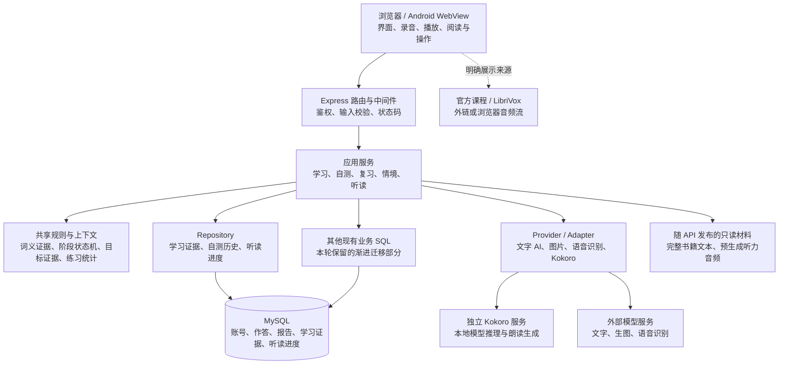

# 架构整改、完整情境任务与听读空间（2026-11-26）

本次实现以 `874ae65c8e1c9bef1b7cee0590f89bfbff9e7486` 为基础，位于 `feat/learning-journeys-library-20261126` 分支。改动在本地完成，尚未推送 GitHub 或发布线上。

## 1. 使用入口与学习方式

- **情境对话**：选择经典场景，勾选“按完整流程练习”，选择路线后开始。词汇认识仍可跳过，普通对话方式保留。
- **当前阶段**：先播放对方开场、回答理解题，再用自己的话交流。需要时可看开场文字和不同表达方法；使用帮助会单独记录。
- **流程推进**：本阶段目标有表达证据后才可进入下一阶段；也可以跳过，保留待练标记。回看、换角色、听音频不直接计为通关。
- **任务小结**：分别查看流程覆盖、独立表达与首次听力理解。可更换条件复练；自定义场景需调整需求，重新生成另一套流程。
- **听读空间**：新增“情境精听”“英语名著”“官方课程与播客”。已有文字 API 不是阅读和五段精听的前置条件。
- **阅读释义**：按住单词满 5 秒查询现有词库；松手、移动或滚动取消。键盘可聚焦后按 Enter。缺词时由用户主动点击 AI 补释，需要已配置文字 API。

这套流程提供“听懂输入 → 尝试表达 → 获得反馈 → 处理下一步 → 小结巩固 → 换条件重练”的学习条件。完成一次任务只代表本次表现，不能承诺已经彻底掌握场景交流或长期记住。

## 2. 所有现有经典场景的覆盖

现有 9 个场景卡片、10 种语义情境均有具体阶段：`bank` 的银行和河岸分别设计，不能合并义项。酒店 10 步、咖啡店 7 步，其余情境各 6 步。

- **酒店**：预约 → 预订确认 → 到店与证件 → 早餐信息 → 房卡与楼层 → 房间检查 → 客房用品请求 → 早餐使用或购买决定 → 退房核账 → 收据、还卡与寄存。可选线上、电话、到店及早餐另购路线。
- **咖啡店**：到店与用餐方式 → 菜单 → 下单 → 口味与规格 → 价格、确认与模拟付款 → 取餐 → 处理不符并结束。可选柜台堂食、外带、桌边点单。
- **餐厅**：入店与座位 → 菜单 → 饮食要求与点餐 → 订单和等候 → 用餐问题 → 账单与离店。可选堂食、外带。
- **问路**：目的地与方式 → 路线 → 时间距离 → 请求澄清 → 复述确认 → 地标和到达。可选步行、公交接驳。
- **银行**：需求 → 资格和材料 → 方案费用 → 澄清条款 → 下一步安排 → 处理时间和查询。仅为语言模拟。
- **河岸**：问候来意 → 步道景点 → 环境时间 → 偏好协商 → 确认安排 → 提醒与道别。
- **面试**：介绍 → 项目经历 → 问题处理 → 岗位要求 → 提问澄清 → 后续安排。可选项目讨论、协作问题路线。
- **购物**：需求 → 比较 → 适合度 → 退换规则 → 模拟付款与收据 → 售后。退换路线对应修改开场、比较与处理需求。
- **校园协作**：目标 → 分工 → 时间 → 障碍 → 交付标准 → 下一步。可选正常规划、延误协商。
- **图书馆**：找书 → 馆藏与位置 → 借阅条件 → 借期与规则 → 续借问题 → 归还确认。

每阶段都有具体英文开场、两个可观察目标、2—3 种参考表达、一道开场理解题。参考表达允许同义处理，不要求照抄固定台词。内置场景的换条件复练实际替换日期、价格、等待时间等；它是有限的教学变式，不是无限生成的真实世界模拟器。

新生成的自定义完整情境必须通过 4—12 阶段结构校验，包括角色存在、阶段 ID 唯一、英文开场、表达长度、听力选项和答案下标。结构校验不能代替真实模型内容质量评审。旧自定义场景仍可普通交流，重新生成后可获得完整流程。

## 3. 实际架构与调用方向

学习、自测和情境是一个 Node.js 后端中的逻辑模块，没有宣称拆成独立微服务。Node.js 是运行 JavaScript 的服务端运行环境；Express 负责 HTTP 路由和中间件。Kokoro 是独立部署的语音推理服务，不应仅因 HTTP 调用就称为公网上的商业在线模型。

本轮明确的边界：

1. `routes/tts.js → services/ttsService.js → adapters/kokoroProvider.js`：路由负责鉴权与请求校验，应用服务负责频率和并发控制，适配器负责 HTTP 和响应校验。
2. 图片生成、可信域名下载与格式归一化移入 `adapters/imageProvider.js`；语音转写传输移入 `adapters/speechProvider.js`。原来的超时、错误映射与安全约束保留。
3. `repositories/learningEvidenceRepository.js` 统一学习证据写入和历史兼容读取；学习、搭配、回忆、九宫格和情境巩固继续复用同一入口。`services/wordLearningEvidence.js` 保留原导出以兼容旧调用，承担证据分析。
4. `services/learningContextService.js` 提供有边界的练习统计与词义证据读模型，自测报告、听读概览复用。一次最多关联 200 个词，报告保留原证据快照。
5. 自测历史、听读进度的 SQL 分别封装在 Repository。其他原有服务仍含 SQL，这是本轮渐进整改的范围，不能据此宣称整个项目已经完全完成 Repository 改造。

数据存放需按实际形式说明：账号、作答、报告和进度在 MySQL；书籍原文及五段音频随 API 包发布；模型文件、配置在运行服务器；已有用户记忆图的存储方式沿用原实现。浏览器直接打开第三方官方学习页面和有声书音频，不经后端冒充平台自有内容。

## 4. 历史关联与效率整改

“同账号、同词书筛选历史”本身不是错误的数据结构；关键是限制范围、索引、执行计划和系统容量。AI 不负责代替数据库做关联查询。

- 迁移 `042` 给既有自测 JSON 增加可索引的生成列和复合索引，保留 JSON 与报告。
- 可比较历史在数据库内筛选并限制最近 20 次，按完成时间、ID 稳定排序。
- 词义分析先用 `Map` 按单词及义项分组，减少为每个词重复扫描所有事件。
- 连接池设置有限等待队列，默认 `DB_QUEUE_LIMIT=100`。满载返回可识别的 503，不无限积压，也不盲目重放写请求。
- AI 解释仍是用户主动调用的附加解释，历史关联及规则分析不依赖用户是否配置 API。

离线 MySQL 对照测量使用 20,000 条合成记录，先测旧结构、再添加生成列与索引，各 25 次查询，两组返回相同的 20 个历史 ID：p95 从 **14.725 ms** 降至 **1.257 ms**。这只验证本机合成数据上的查询优化，未验证生产并发、吞吐量或全国规模容量。后续容量测试还需区分数据库、Node 进程、模型服务商配额和语音推理资源。

## 5. 多角色与阶段技术机制

- 用户身份固定；当前交谈对象、各角色职责、共同事实保存在会话中。
- 单次模型请求只针对当前对象，私人聊天记录按对象筛选。
- 已核对的目标引用形成有限的共享任务证据，帮助其他角色承接信息；“用户提出请求”不自动成为“真实业务已执行”。
- 阶段切换由服务端状态机处理，通过 `expectedRevision` 防止多端旧状态覆盖。角色切换另核对当前轮次。
- 目标必须对应当前阶段，并引用本轮用户实际表达，不能用未来目标提前通关。
- 同一阶段有独立表达、提示后表达和首次听力理解的不同记录；跳过保留缺口，回看不发奖励。
- 完整任务按阶段预留轮次，防止酒店流程在原来的 8 轮限制下提前结束。整段任务不会因某一步模型说 `taskComplete` 就结束。

共享阶段定义位于 `shared/scenarioWorkflows.js` 与 `shared/completeScenarioContent.js`，前端预览和服务端使用同一份内容，避免两边步骤不一致。

## 6. 听读材料、来源及复现

### 平台内可用材料

- 5 段原创短听力：酒店入住、客房用品、咖啡点单、请求澄清、退房核账；每段两道理解题。
- 音频由本地 Kokoro 实际生成，标为合成朗读；已随 API 数据目录提供，不要求用户配置 API 或在首次播放时等待合成。清单校验文本 SHA-256 和音频 SHA-256，防止脚本更新却播放旧音频。
- 记录每次听力作答和是否展开文本，不把听过材料直接算为单词掌握；本轮推荐难度是教学标签，未经真实人群 CEFR 校准。
- 《爱丽丝梦游仙境》完整 12 章、《傲慢与偏见》完整 61 章，来自 Standard Ebooks 官方源码，保留来源、固定 Git 提交、文本哈希及 LICENSE 原文。
- 爱丽丝 12 章可播放 LibriVox 真人朗读；外部录音与文本可能有细微版本差异，未做逐句同步。外部网络不可用时提示来源入口，平台内五段精听与阅读原文仍可使用。
- 阅读位置按账号、书籍、章节、段落保存；释义是词典候选义项，不冒充已经理解当前文意的全文翻译。

### 官方入口

- [CEFR 行动导向关键概念](https://www.coe.int/en/web/common-european-framework-reference-languages/key-concepts)：设计参考是接收、产出、互动及完成现实任务，未宣称平台分数获得 CEFR 认证。
- [VOA Let’s Learn English](https://learningenglish.voanews.com/p/5644.html)、[VOA 使用说明](https://learningenglish.voanews.com/p/6861.html)：平台提供官方课程、播客入口；没有将第三方新闻社素材打包转载。
- [British Council 分级听力](https://learnenglish.britishcouncil.org/free-resources/listening)：官方学习外链，未把免费访问等同于素材可转载。
- [Standard Ebooks 来源政策](https://standardebooks.org/about/standard-ebooks-and-the-public-domain)：保留原作公版与编校贡献 CC0 的来源说明。
- [Alice 官方源码](https://github.com/standardebooks/lewis-carroll_alices-adventures-in-wonderland_john-tenniel)：提交 `9e5eb58995d9fd2f609363d14786d8b0166bbbb9`。
- [Pride and Prejudice 官方源码](https://github.com/standardebooks/jane-austen_pride-and-prejudice)：提交 `a77a2dbbc0d11a17d6c68c581f17e26a65bd8168`。
- [LibriVox Alice 官方录音页](https://librivox.org/alices-adventures-in-wonderland-by-lewis-carroll/)：12 条实际 MP3 地址已检查 HTTP 200 与音频类型；不保证各地区网络始终可达。

复现文本导入：克隆上面两个官方仓库，切换到已记录提交，再执行 `python scripts/import-standard-ebooks.py --alice <仓库路径> --pride <仓库路径>`。脚本检查章数并保留声明，不依赖抓取全站。

复现短听力：在独立本机 Kokoro 服务启动后运行 `node scripts/verify-listening-audio.mjs <输出目录>`，可用 `VERIFY_AUDIO_URL=http://127.0.0.1:端口/synthesize` 指定本机测试服务。脚本通过真实路由、应用服务和适配器生成 WAV；教材或声音更新后需同步重新生成文件和哈希清单。

## 7. 验收证据与边界

- 最终后端回归共 **725 项：724 通过、0 失败、1 跳过**，Vite 生产构建通过。跳过的是原有需显式开启的独立拼写集成测试，不是新增失败。最终日志位于工作区 `output/implementation-20261126/`，该目录不打包进入产品仓库。
- 新增检查覆盖全部内置路线、阶段目标约束、状态冲突、账号隔离、角色范围、普通/完整模式兼容、自定义生成额度、听力服务端判分、阅读位置及五秒按压取消机制。
- 五段音频经过实际本机推理并校验 WAV，长度分别约 20.59、15.54、17.39、21.03、19.69 秒。有效音频文件与哈希校验不等于人耳质量评审。
- 数据库测试使用独立实例 `127.0.0.1:33087`，语音使用独立端口 `30031`；没有对原有数据库或线上服务器执行测试重建。
- AI 自动化使用明确的模拟响应验证协议及状态机，尚未代替真实文字模型对多阶段内容质量、角色连贯性和评分准确性的验收。
- 按本次用户选择先完成代码验收，未完成浏览器全流程走查与真实手机五秒长按测试。
- 没有开展本平台真实用户的延迟回忆、迁移任务与 A/B 学习效果实验，不能报告记忆提升比例。

## 8. 发布与数据兼容

迁移 `042` 仅增加列和索引；`043` 新建听读进度及听力作答表。没有账号删除、词库清空或学习记录重建语句。旧接口默认保持普通对话；新版界面明确选择完整流程，旧对话记录保留。

正式发布前应备份数据库，核对既有迁移清单，安排适合执行表结构变更的窗口，再运行现有迁移命令；保留数据库卷和语音模型卷。API Dockerfile 已复制 `server` 与 `shared`，因此教材、音频和共享流程会随包发布。不要用测试库重建命令替代上线迁移。上线后还需对最终版本补做真实 AI、音频播放、手机阅读和旧账号续练验收。

## 9. 对老师问题的简明回答

**Node 后端是什么？** Node.js 是服务端 JavaScript 运行环境，Express 接收请求。业务模块在同一应用中，MySQL 和 Kokoro 是另外运行的服务。

**公共部分在哪里？** 学习、搭配、回忆和情境结果共用学习证据写入；自测和听读共用练习上下文读取。阶段和角色规则由共享定义与服务端状态机统一执行。新 Repository 隔离对应 SQL，适配器隔离模型通信。

**历史数据如何关联，是否会“爆库”？** 先按用户、词书、版本及时间用索引查询有限历史，再做规则分析；AI 解释是后续可选步骤。已经测量本机查询优化并限制连接池队列，但需要真实负载测试才能回答容量上限，不能凭这次测试承诺全国并发。

**多个角色怎么实现？** 同一个文字模型按当前角色职责生成一人的回复，按角色筛选对话，并承接已核对的共同任务信息；换角色不重置用户身份和阶段进度。

**怎样判断用户会了？** 分开观察听懂关键信息、是否依赖参考、是否完成各阶段目标，再隔天换条件复练。一次通关不是能力认证。

**九宫格算法是否也在本次重写？** 没有。本轮主要整改架构边界和情境听读流程，九宫格继续使用现有出题实现；如需专门优化题目难度、干扰项或抽样算法，应另做代码审查和题目质量实验，不能将其列为本轮已完成成果。
