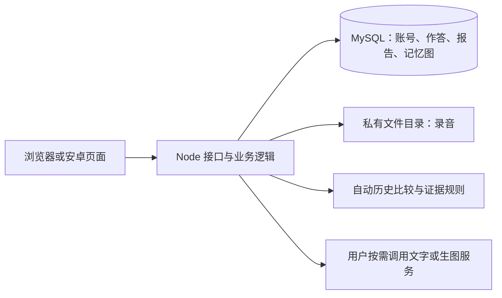

# 会议要求落实：历史关联、改善依据、看图长期复习

本轮在 2026-11-18 已整合的代码上继续实现第 1、2、3 项。保留邮箱验证改动与所有已有账号兼容要求。新增 `032_word_evidence_and_image_review.sql`，只添加表和索引，不更新或重建账号表。

## 1. 同一个词在不同练习中的表现

自测报告新增「这些词在哪一步还需要练」。按当前账号、当前词书、词库 ID 与明确保存的义项关联当前测试词，分别展示自测辨义、日常辨义、搭配填空、独立回忆、看图辨义和情境使用的记录、最近结果及时间过程。报告优先列出待巩固词，可以直接进入该词的搭配。

例如 `bank` 的「河岸」和「银行」分开；会认「河岸」不代表能用「银行」这个意思。记录中没有明确义项的搭配、旧日常作答和旧回忆单独列在「该词另有记录，义项尚未确认」，不依据今天的词典反推旧题，不把短语中文翻译直接当作目标单词的词义。

新日常辨义、搭配和回忆在原作答事务内写入不可变证据；情境使用读取原有账号下的词义证据，看图作答也写入同一证据表。旧记录继续读取且按来源去重，不重复计数、不伪造缺失信息。报告的近期练习范围为测试完成前近三十天，自测历史继续使用同词书、同方法和可比较版本的最近二十次。报告保存原始证据快照，后来的学习不改写旧报告。

## 2. 区分成绩变化与学习改善

报告新增「成绩变化能说明什么」，自动显示本次有多少计分题在最近二十次可比较测试中出现过，以及重复题、未在该窗口出现的题分别答对多少；题目快照缺失时标为无法核对，不能归为新题。展示个人 A/B 卷次数与累计成绩，同时明确这些个人统计不能证明两卷难度相等。

分档趋势仍然描述测试分数的变化。只有某个明确词义曾自测答错、本次辨认正确，而且最近一次辨义或回忆失败之后，存在至少两个不同业务日期、距前次已记录接触至少 24 小时、更换语境、未用提示的独立延迟复测，才给该词义「有独立回忆记录支持改善」的提示。提示后答出、同日刷题、未换语境、图片选对、其他词义、未来记录和缺少准确作答时间的旧记录，都不能凑足这个条件。出现新的遗忘时，旧的成功记录不继续充当当前改善依据。

这是一条保守的产品提示规则，不是科学上已验证的能力标准。它不把部分词的表现扩展成整体英语水平，也不把 A/B 原始分数直接换算成精确词汇量。每次自测仍自愿，未做自测不拦截学习或复习。

基础分析自动完成；文字 AI 仍需用户点击才调用。报告与解释升级为 v3，AI 从有证据的综合结论、可靠性提示和具体词的记录中选择重点，服务端呈现受控文字。旧解释保留但未经新版校验不展示，不自动付费重新生成；没有可用 API 仍能看完整基础报告。

### 真实学习效果还需要怎样验证

先用自愿参与者检查题目歧义和流程，再安排不同起卷顺序的 A/B 试测；记录日期、试卷、题目重复程度及各档成绩。学习后可自愿在至少隔天、数日后做不看原图、换语境的独立回忆或使用任务，分别观察辨义、搭配和回忆。比较时要考虑试卷难度、熟题、提示以及期间其他学习。当前代码已提供个体记录和证据限制；真实人群等值校准和学习效果研究尚未完成，不能用自动化测试数量代替。

## 3. 看图练习保存与长期复习

`/api/v1/image-recall` 提供状态，`/sessions` 开始或恢复，`/sessions/:id/answers` 提交选图或跳过。题目由服务器从内置、方位示意图及该用户已生成图片组成，作答前不下发正确标记、目标义项和选项词名；提交时服务端校验并判分，不能由页面上传一个「答对了」直接记分。

保存选择、漏选、多选干扰、跳过、来源、目标词义、下一次复习时间及该轮完整状态。提交失败保留选择供重试；同进程合并重复提交，多实例通过事务和唯一约束去重。刷新保留当前模式并恢复已答进度。未答的个人图在恢复时读取最新图片版本，已答快照保留。答案显示后才能进入改图面板，避免先查看词义再当作独立作答。

答对、答错和跳过均进入独立的图片复习安排；同日反复答对增加尝试记录但不刷长间隔。看图页有「练到期图片」「重练看图错题」，今日回顾有到期入口；已匹配词库的看图错词或跳过记录进入原错题本，并可再进入文字独立回忆。图片辨认成绩不修改整体单词 SRS 或直接标记掌握。

没有匹配当前词书的内置词仍可保存图片任务，但不伪造词库 ID，也不加入该词书的自测词级分析。缺失或删除的个人图片不会生成虚假成绩；重新生成后可继续练习。组题只读取现成图，不自动调用文字或生图 API。

## 老师当时在问什么

老师问「模块到底怎么分、放在哪里」，是在核查你是否理解系统结构。自测、错题本、看图是逻辑功能；页面在浏览器，接口业务在 Node 服务，账号、作答、报告和个人记忆图在 MySQL。雅思录音保存在服务器私有文件目录。平台密钥由服务器私有配置提供，个人 Key 沿用加密保存方案。逻辑模块不等于独立部署的服务。

老师问「把历史存进去以后怎么产生关联」，是在追问历史有没有参与下一次判断。仅保存一排测试日期不够；现在报告会比较多次成绩、复查历史薄弱词，并读取同词同义项的不同练习，明确哪些能认、哪些需提示、哪些仍未答出。AI 解释只在这些依据上组织重点，不承担凭空判断能力的职责。

老师问「自测有什么用」，重点是有证据地选择学习起点、找到薄弱处、观察后续变化。未自测者也能正常学习，报告如实显示缺少相应证据；自测者多了辨义样本和历史比较，不能因此直接认定词汇量或整体英语水平。

老师提议点击图片闯关，是让学习后有一次主动回答和反馈。现在图片互动进一步有了长期记录与后续复查，可以观察是否只能认原图，或换到文字后仍能独立回忆。图片保存与图片答题成绩保存是两件不同的事。

老师说介词等抽象词图片不好理解，核心是图是否表达了具体义项。介词表达空间、时间等关系，并非没有意义。方位词已有统一的关系图；时间义、目的义和其他抽象词仍应分别验证。提示词更具体不等于已经证明生成图片准确。

老师问生图速度，是要求找出实际瓶颈。代码已有场景设计、绘图服务、下载、图片转换和总耗时记录；本轮练习复用现成图，减少答题等待，但没有宣称外部模型本身变快。完整线上耗时仍需实测。

会议中的「FF Pro」从代码看很可能是 `ffprobe`：它检查录音能否解码及实际时长等文件属性，之后才由语音识别服务转成文字，再由文字 AI 对真实转写作内容反馈。文件合格、转写成功、内容反馈、专业发音评价是不同环节，当前不能把转写结果当作发音评分。

老师问雅思 Baseline，是要求明确目标分对应的能力，再约束材料、练习和反馈。当前已有目标分和分科训练，尚需进一步将分档能力描述落实为内容选择与反馈依据。词汇量若作为平台目标，应明确是平台学习规划，不能仅凭数量宣称达到雅思分数。官方口语包含流利与连贯、词汇、语法、发音四个评分维度，见 [雅思官方说明](https://ielts.org/take-a-test/test-types/ielts-academic-test/ielts-academic-format-speaking)。本轮第 1–3 项没有新增雅思分数校准或发音评分。

## 验证与发布

测试仅使用本机独立库 `beileme_meeting_review_20261118_test`，不读取或重建线上用户数据，不发送真实邮件，不调用付费 AI。记录位于 `output/meeting-review-20261118/`。部署时先备份并运行增量迁移 031、032，使用 API Dockerfile 新增的 `src/utils/imageRecall.js` 依赖；不运行测试重建。本轮尚未部署或打包 APK，GitHub 同步状态以仓库提交记录为准。

已通过全量 653 项测试、零失败及最终网页生产构建；新增覆盖词义隔离、未确认义项、熟题标记、24小时间隔及换语境条件、重新遗忘、图片判分防伪、并发幂等、刷新恢复、错题本、到期安排、同日不刷间隔、个人图版本更新，以及报告冻结和账号隔离。运行日志为 `full.log`、`targeted.log`、`build.log`。
